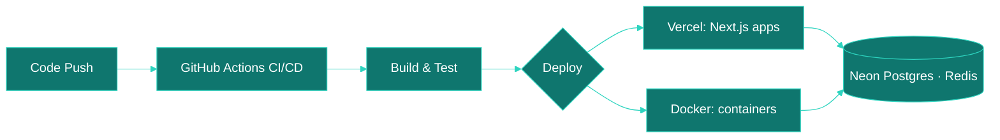

<div align="center">


<a href="https://git.io/typing-svg"></a>

<br/>

<a href="https://gowreesh.me"></a>
<a href="https://linkedin.com/in/gowreesh"></a>
<a href="mailto:vt.gowreesh43@gmail.com"></a>

</div>

---

## `> whoami`

```ts
const gowreesh = {
  name        : "Gowreesh V T",
  education   : ["VIT Chennai: B.Tech CSE", "IIT Madras: BS Data Science"],
  role        : "Full-Stack Developer Intern",
  location    : "Erode, Tamil Nadu 🇮🇳",
  focus       : ["Production Web Apps", "WebOps", "CI/CD", "System Design"],
  currentWork : ["B2C Fleet Compliance PWA", "MIC Email Client", "NotesFlow"],
  community   : "Microsoft Innovation Club: Web Development Lead",
  stack       : ["Next.js", "Node.js", "PostgreSQL", "Docker", "Vercel"],
};
```

---

## 🚀 Flagship Projects

<table>
<tr>
<td width="50%" valign="top">

### 🛰️ Fleet Pilot
> **Vehicle Tracking & Compliance Platform**: Founder

Used in production by **200+ customers**, tracking **6,000+ vehicles**. Built for fleet operators and low-literacy drivers in Tier 2/3 Indian cities.

- 🔍 VAHAN RTO scraper + Tesseract.js captcha solving
- 📸 Client-side OCR certificate scanner
- 💳 Razorpay payments · 📲 SMS/push reminders
- 🌐 Tamil i18n · 📍 PIN/pattern login
- 🚀 Vercel + GitHub Actions CI/CD

**Stack:** `Next.js 14` `PostgreSQL` `Prisma` `NextAuth.js` `Serwist PWA` `Playwright`

<a href="https://github.com/Gowreesh-VT/VehicleTrack-Pro"></a>

</td>
<td width="50%" valign="top">

### 🗓️ FFCS Timetable Planner
> **Used by 10,000+ VIT Chennai students**

Build, validate and share FFCS (Fully Flexible Credit System) timetables for course registration.

- 🧩 Timetable creation with clash validation
- 🔎 Course and slot browsing
- 🔐 Authenticated sharing and saved timetables
- 🚦 Feature-flagged rollouts (Flagsmith)
- 📈 Monitoring with Sentry and PostHog
- 🧪 Load-tested for registration-day traffic

**Stack:** `Next.js 16` `React 19` `MongoDB` `NextAuth.js` `Tailwind` `Upstash Redis`

<a href="https://github.com/Gowreesh-VT/FFCS-Timetable"></a>

</td>
</tr>
<tr>
<td width="50%" valign="top">

### 📧 MIC Email Client
> **Full-Stack Email Platform**: Production Intern Project

- 🔀 4-level SMTP priority chain with failover
- 📊 Bulk send with CSV import
- 📝 HTML template editor (CodeMirror 6)
- 📡 Open/click tracking + audit logging
- 📄 Certificate PDF generation
- ⏰ Scheduled sends via GitHub Actions cron

**Stack:** `Next.js 14` `PostgreSQL/Neon` `Prisma` `Redis` `Shadcn/ui`

<a href="https://github.com/Gowreesh-VT/Custom-Mail-GUI"></a>

</td>
<td width="50%" valign="top">

### 📝 NotesFlow
> **Local-first notes & tasks app, in the spirit of TickTick**

- 📥 Smart views: Inbox, Today, Next 7 Days, Completed, Trash
- ⚡ Quick add: `Pay rent tomorrow !high #bills`
- ✅ Priorities, due dates, subtasks, auto `#tags`
- 🧾 Markdown editor with live preview and export
- ⌨️ Command palette, shortcuts, light/dark themes
- 📴 Offline-first PWA with optional cross-device sync
- 🔔 Web Push reminders, even when the app is closed
- 🤖 Daily AI-assisted improvements via GitHub Actions

**Stack:** `Next.js` `TypeScript` `Tailwind v4` `Zustand` `Drizzle` `Postgres` `Auth.js` `Vitest`

<a href="https://github.com/Gowreesh-VT/notesflow"></a>

</td>
</tr>
</table>

---

## 🎙️ Microsoft Innovation Club, VIT Chennai

<div align="center">


</div>

Leading web development for the club: building and running its platforms and event infrastructure, organizing hackathons and events, and hosting technical workshops for mixed-skill audiences.

| Focus | What I do |
|---|---|
| 🛠️ **Web & Infra** | Club platforms, event sites, self-hosted tools |
| 🏁 **Events** | Hackathons, inductions, flagship club events |
| 🎤 **Workshops** | 10-session series: full-stack, DSA, cloud & WebOps, cybersecurity, AI/ML |
| 🔗 **Finale session** | Build Your Own Cryptocurrency: Solidity, Remix, MetaMask, Sepolia, ERC-20 |

---

## ☁️ WebOps & Cloud



| Layer | Tools & Services |
|---|---|
| 🔄 **CI/CD** | GitHub Actions · Vercel Preview Deploys · Cron workflows |
| 🐳 **Containers** | Docker · Docker Compose |
| 🌍 **Hosting** | Vercel · Nginx on Linux |
| 🗄️ **Databases** | Neon (Serverless Postgres) · MongoDB · Supabase · Firebase |
| ⚡ **Caching** | Redis · Upstash · Vercel edge caching |
| ☁️ **Also explored** | AWS (S3, EC2) · GCP (Cloud Run) · Azure |
| 📊 **Monitoring** | Sentry · PostHog · Vercel Analytics · GitHub Actions logs |

---

## 🛠️ Tech Stack

<div align="center">

**Languages**


**Frontend**


**Backend & Databases**


**WebOps, Cloud & DevOps**


</div>

---

## 🎓 Certifications

<div align="center">

| 🏅 Certificate | 🏢 Issuer | 🔖 Domain |
|---|---|---|
| Meta Full-Stack Developer | Meta / Coursera | Full-Stack Engineering |
| MongoDB Developer | MongoDB University | NoSQL & Database Design |
| Redis Certified Developer | Redis University | Caching & Data Structures |

<details>
<summary>More certificates</summary>

Meta Python Professional · SQL Associate (DataCamp) · Responsive Web Design (freeCodeCamp) · Introduction to AWS

</details>

</div>

---

## 📊 GitHub Stats

<div align="center">


</div>

---

## 🏆 GitHub Trophies

<div align="center">

<a href="https://github.com/ryo-ma/github-profile-trophy"></a>

</div>

---

## 🐍 Contribution Snake

<div align="center">


</div>

---

<div align="center">

**Open to collaborations, internships, and building things that actually matter.**


</div>
